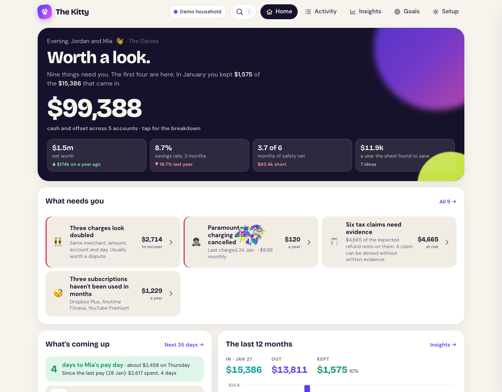
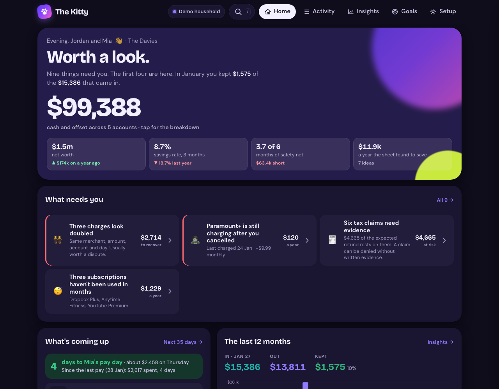
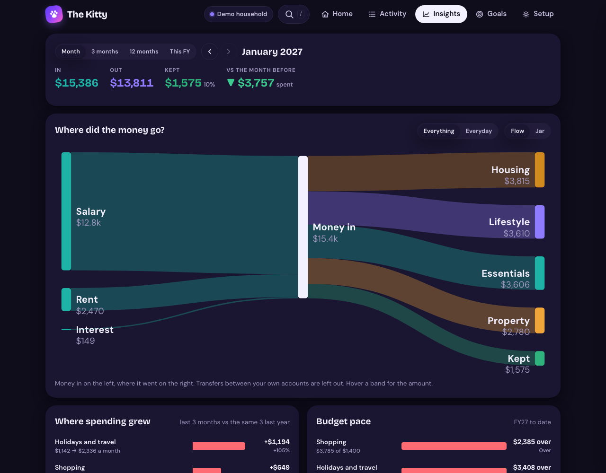
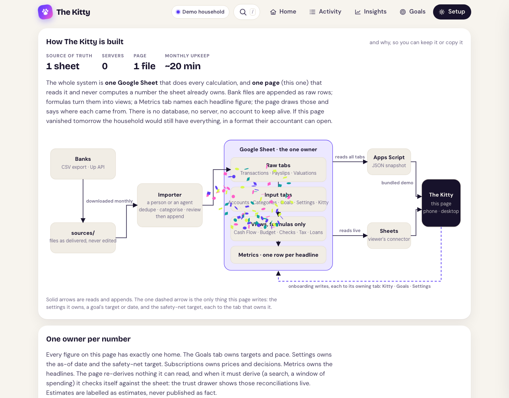
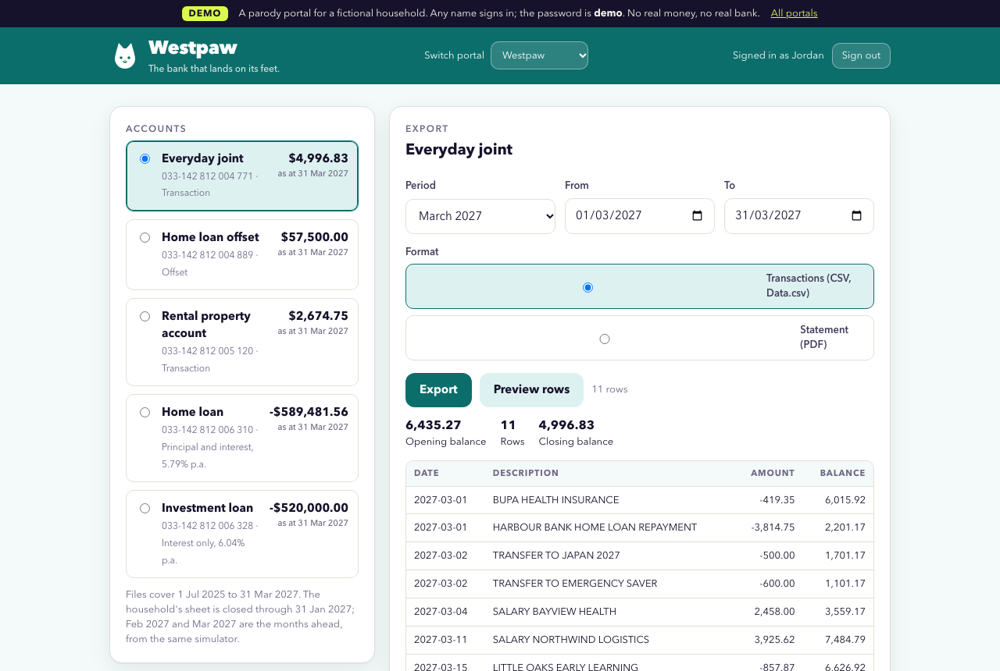
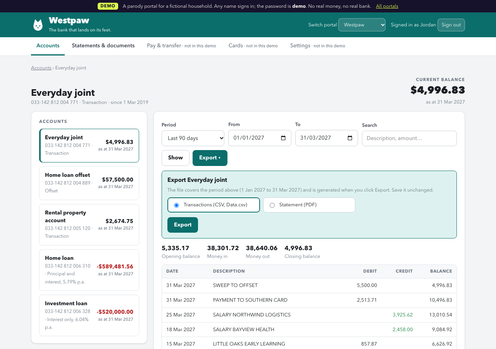
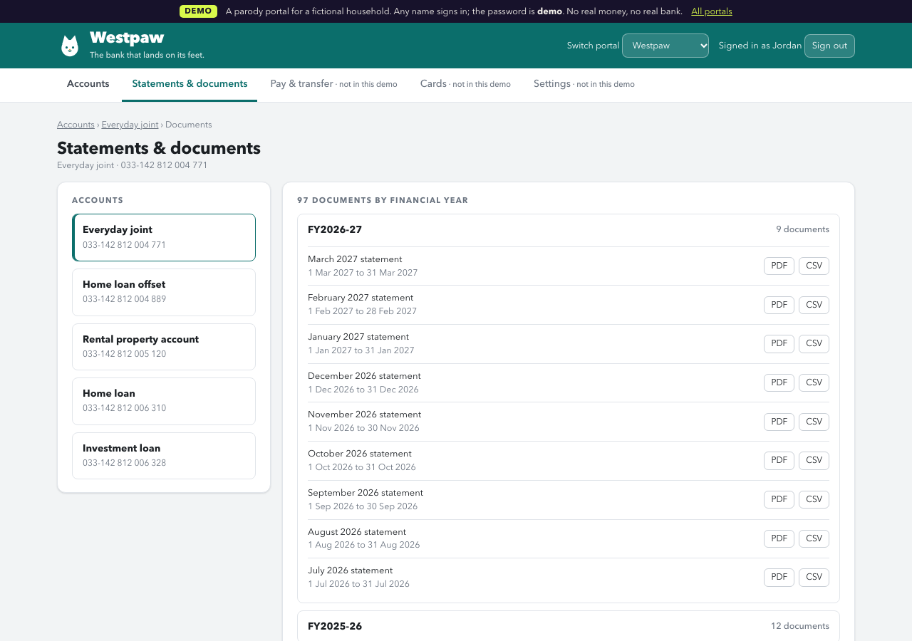
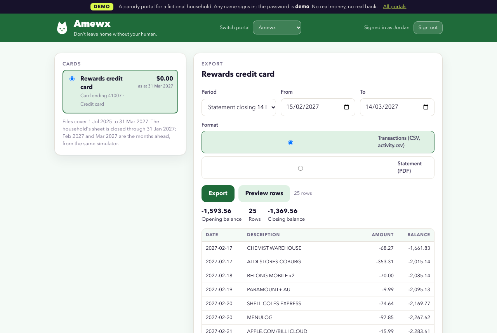
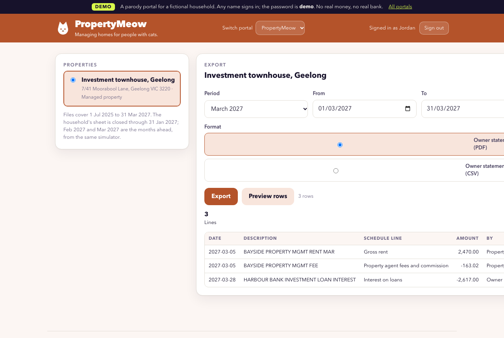
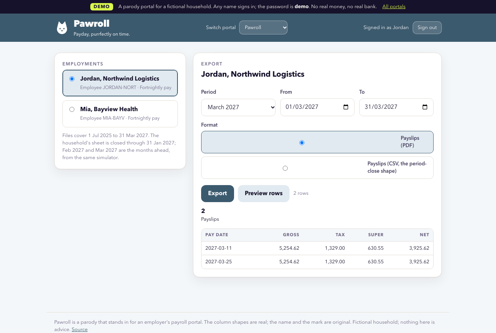

# The Kitty


A money page for one household, built the way a neobank would build it and kept the way a spreadsheet is
kept. One Google Sheet owns every number; one published page reads it, says what needs a person, shows
where the money went, tracks goals as money ("$11k of $12k"), installs on a phone, and answers questions
as a planner's note. No server, no database, no telemetry, nothing to pay for.

**Try it:** https://claude.ai/artifact/QH2gsDP8sHZmgMVKBtkwxn (the fictional Davies household; works on a phone,
add it to your home screen). **Copy the sheet:** https://docs.google.com/spreadsheets/d/16BNQv2jTt9G3Yfbkj1NwgaAxDjBibCth40wdNXWf3aA/copy

| | |
|---|---|
|  |  |
|  |  |

## Status

Version 2.0 is the published page, reading the "Digital Davies v2" ledger sheet. Version 1.1 was verified live on 3 November 2026: live read and write through the viewer's Google Sheets
connector, the onboarding's writes, Ask the Kitty, two month-end closes through the import pipeline, light and
dark themes, phone install. See `CHANGELOG.md`; known limits are listed at the end of this file.

**2.0, phase C (widgets, signals, the canvas, the kit gallery), 5 November 2026:** Home is widgets the sheet switches on, arranged per person, on GridStack.

**2.0, phase B (the row and the review), 4 November 2026:** Activity on `EntryRow` with monograms and
brand icons, the merchant dictionary, the Review queue with its sheet writes, the fortune cookie that proposes rules, and
"Worth it?"; the fortune cookie's proposal, rule write, category write and Decisions row verified live against the v2 sheet (rule `R0086`). See `CHANGELOG.md`.

**2.0, phase A (the ledger), 4 November 2026, on branch `v2-ledger`:** the data model below now carries every store
of value, on a copy of the demo sheet ("Digital Davies v2", `kitty.config.json`). `python3 build.py --v2` builds the published page.


## The Digital Davies Standard

[`standard/`](standard/README.md) is the data model underneath: one open schema for a household's whole financial life, from a coffee
to a lodged return to a laptop due for replacement. Everything derived rebuilds from evidence and decisions, one fact is recognised
once, nothing date-effective rewrites history, and twenty laws check that it all can be true at once. The Davies family is its
benchmark: `node standard/world/build.js && node standard/eval/all.js`. The sheet and the page here move onto it in stages.

## What is in here

| Path | What it is |
|---|---|
| `src/engine.js` | Every number: parsing of connector strings and snapshot values, the model, verdict, upcoming, goals, leaks, search. Pure functions; `node --test test.js` runs them with the sheet as oracle. |
| `src/app.js` | The page: Home, Activity, Insights, Goals, Records, Setup; onboarding; drawers; the three writes; Ask the Kitty. |
| `src/kit/entry-row.js` | The kit: `EntryRow` (monogram, brand category icon, clean name, signed amount, badges), `EntryList` grouped by day, `ReviewCard`, `WorthRow`. Pure functions from the model to HTML; the page binds the clicks. |
| `src/kit/widgets.js` | The widgets: manifests, what switches them on, and the layout logic, pure and tested in node. `src/app.js` mounts them on GridStack (`src/vendor/` holds its stylesheet). `python3 build.py --v2` also writes `dist/kit.html`, the component gallery. |
| `src/kit/records.js` | The Records tab: draws `data/standard-view.json` (generated by `standard/tools/view.js`) and computes nothing. The page binds the clicks. |
| `merchants/` | The merchant dictionary (370 Australian merchants and generic descriptors with patterns, categories, hues, websites) and the category-to-icon map; `README.md` records the miss rate. |
| `src/style.css`, `src/shell.html` | Tokens (light and dark, four accents), components; the brand sprite (`brand/icons/sprite.svg`) is inlined at build. |
| `src/data-sources.json` | How a household gets bank data in, by country and institution, with the landing rules. Rendered on Setup. |
| `data/snapshot.json` | The Davies household as JSON, pulled from the sheet's bound Apps Script. Fictional, so it is bundled. `data/snapshot-v2.json` is the same household from the v2 sheet, with the ledger tabs. |
| `snapshot.py` | Refreshes `data/snapshot.json` from the Apps Script JSON feed (`apps-script/Code.js`, `?format=json`); `--v2` refreshes the v2 snapshot once the copy's script is deployed. Until then `tools/grid_to_snapshot.py` builds it from typed connector reads. |
| `kitty.config.json` | Sheet IDs, feed URLs and the page URL: the 1.1 demo sheet the public page reads, and the v2 sheet phase A migrated. |
| `build.py` | Bundles `dist/kitty.html` (publish this) and `dist/local.html` (open locally). `--no-snapshot` for a page with no data in it; `--v2` for `dist/kitty-v2.html` against the v2 sheet. |
| `test.js` | Pinned tests on a frozen month (`fixtures/snapshot-2026-11.json`) plus invariants that also run on the live snapshot: transactions add up to the Cash Flow tab every month, accounts to the Cash metric, IDs unique. |
| `test-v2.js` | The ledger's tests: the sheet's Balances tab is the oracle for every account at every month end; the transfer invariant; signals; on the live v2 snapshot and the fixtures `everyday-only` and `everyday+property` (cut by `fixtures/make-v2-fixtures.py`). |
| `skills/bank-export/SKILL.md` | The agent skill for the monthly export, country-aware, credential-free. |
| `portals/` | The parody portals on Vercel (https://the-kitty-portals.vercel.app): eight years of the household's files, static pages, four Node functions, `history.py` and `build-data.py`, the Playwright proof. |
| `sources/` | The bank files as delivered, one per account per month since March 2019, in each institution's shape; what the importer reads. |

## Build, test, publish

```bash
python3 snapshot.py          # after a month-end close
node --test test.js
python3 build.py             # dist/kitty.html
```

Publish `dist/kitty.html` from Claude with these capabilities: `mcp` → Google Sheets with
`get_values`, `get_spreadsheet`, `update_values`, `append_values`; `sample`; `user`; `db`; `downloads`.
Icon word: `cat`. After the first publish, set `KITTY_PAGE_URL` in `build.py` so the Setup tab's QR
code points at the page, and publish again.

Local check: `python3 -m http.server 8765 --directory dist` then open `/local.html`. The page runs
on the bundled data without any connector; connector features show as absent.

## The data model, in one paragraph

Raw tabs are append-only (Transactions, Payslips, Valuations). Input tabs are set up once (Accounts,
Categories, Goals, Loans, Assets, Subscriptions, Settings, and the Kitty tab this page owns). View tabs
are formulas only (Cash Flow, Budget, Savings Finder, Mortgage Scenarios, Tax Forecast, Compliance
Checks, Net Worth). Metrics names each headline figure once. The page draws from Metrics and the views,
derives only what a search or a window needs, and checks its derivations against the sheet in the trust
drawer. It writes three things, each to the owning tab: Kitty settings, a goal's target or date, the
safety-net target.

**The ledger (sheet_version 2).** Every store of value is a row on Accounts with a type (transaction, savings,
offset, credit card, loan, property, vehicle, device, shares, crypto, super, smsf), an owner, an opening anchor and
date, a class, a valuation method (ledger, statement, appraisal, market, estimate) and a status (active, beta,
closed). Everything that happens is a row on Entries of one of three kinds: a transaction (money moved, with Up's
vocabulary: raw text, description, status, created at, settled at, transfer id and account, foreign amount), a
trade (units at a price) or a valuation (a value observed on a date, from a statement or an appraisal). Balances
holds the balance of every account at every month end: the anchor plus entries for a ledger account, the last
valuation carried forward for the rest; Net Worth is derived from it. Contracts holds recurring obligations
(subscriptions, insurance, the lease, loan terms) with provider, cadence, next date and cover; Decisions holds
human judgments keyed to an entry, contract or account; Rules maps descriptors to merchant, category, tax label
and property. Transactions, Valuations, Assets and Subscriptions are formula views over these, so every 1.1
formula keeps working and every existing ID is stable. A transfer is one event on two accounts paired by
`transfer_id`, and the sheet checks the invariant (a mate of the opposite amount within four days; pairs never
count as spending; each month's change in total balances equals income less spending plus valuation changes)
alongside the engine. Loan terms stay on the Loans tab (Mortgage Scenarios reads it); Contracts mirrors them by
formula. On a v2 sheet the month-end rows land on Entries (columns A to T, `entries.json` from the importer), by
explicit range at the first empty row, never by appending to a tab with helper columns.

## The month-end close, as the banks deliver it

Two months (December 2026 and January 2027) were closed this way on 3 November 2026 to prove the model.

```bash
python3 period-close/simulate.py 2027-02      # demo only: writes the month's files as each bank would
python3 snapshot.py                     # the sheet as it stands, for de-duplication and history
python3 period-close/import_month.py 2027-02  # reads sources/, refuses rows already in the sheet, categorises
# settle period-close/2027-02/review.md in overrides.csv, run the import again, then append rows.json,
# payslips.csv and valuations.csv to the sheet, move Settings → As-of date, update Last used, read Compliance Checks
```

- Files land in `sources/<account id>/<download date>/`, one per account, in the institution's own shape
  (`period-close/adapters.py`: Harbour Bank writes like Westpac with debit and credit columns and a running
  balance; Southern Card like American Express with charges positive; Wattle Credit Union like ING). The
  adapter folds each into one signed amount; the file is never edited.
- Overlapping exports are safe in one run: each row is taken once, and a genuine double charge survives because the most copies in any one file is how many are real. Where a file prints a running balance, its last balance in the month must equal the sheet's opening balance plus every row to that date; if not, the run exits 2, `rows.json` is empty and the rows wait in `rows.held.json`. Card files print no balance, so they carry no such check.
- `import_month.py` refuses any row the sheet already holds (same date, account, description and amount,
  counted), so a file imported twice appends nothing while a genuine same-day double charge survives for the
  sheet's duplicate check to flag. December re-imported after it was appended: 51 rows, 0 to append.
- Txn IDs continue from the sheet's last. Helper columns on Transactions, Payslips and Valuations are
  ARRAYFORMULAs, so appended rows need nothing else. The one thing to get right by hand is the first empty
  row: the header makes T0001 row 2.
- The close is done when every Close check on Compliance Checks is OK and `close.items_missing` is 0.
- The sheet's bound Apps Script serves the JSON feed only while the Kitty tab says `public_feed = yes`. The demo sheet says yes because every number in it is fictional; a household with real money leaves it off and reads live through the connector instead.

## Portals (the end-to-end proof)

**https://the-kitty-portals.vercel.app** holds the fictional Davies household's whole financial life, from the day the
home settled in March 2019 to two months past the sheet's as-of date, behind seven parody portals that work the way
the real ones do: Westpaw (the Westpac CSV shape), CommBark (CommBank's headerless four-column export), Amewx (the
American Express statement shape, statement periods closing on the 14th), PING (the ING shape), PropertyMeow (owner
statements per investment property), Pawroll (payslips and income statements) and Purrsure (landlord, home and car
insurance renewals). Sign in with **any name and the password `demo`**. Each portal has an overview with balances, an
activity page per account with period presets (every financial year, the last two years of months, everything since
the account opened), search, paging through thousands of rows, an Export panel, and a Statements & documents page
listing every monthly statement, end-of-year summary, payslip and renewal by financial year. Every download is
generated on the server with `Content-Disposition: attachment`: CSV in the institution's exact column shape, PDF
through pdf-lib.

The data is one dataset, `portals/data/months.json` (8 years, 4,179 transactions over 7 accounts, 417 payslips,
about 1,250 documents), built by `portals/build-data.py` from three sources that never disagree: `portals/history.py`
invents March 2019 to June 2025 (a refinance, the Geelong rental bought in 2021, a card in 2020, a saver in 2022, a
baby, a car, rate rises, pay rises, price rises) and lands every account to the cent on the sheet's opening balances;
`data/snapshot.json` supplies every month the sheet holds unchanged; `period-close/simulate.py`, run in a scratch copy,
supplies the two months ahead. The same build writes the history as the banks would have delivered it, one file per
account per month under `sources/<account>/<download date>/` (`--write-sources`; 417 files, the simulator's own
closed months left byte-identical), so an agent can rebuild the sheet from files alone: open each account on the
Accounts tab at its balance the day before the first file, then import month by month in order. The importer's
closing-balance check holds a month imported out of order. One account, Jordan's old everyday at CommBark, is not on
the sheet and not under `sources/`; it exists so the CommBank shape has an account behind it, and it is labelled.

The CI job `portals` proves the path with Playwright (Chromium only): sign in, download every bank shape for the first
month after the sheet's as-of date, check names, headers, CRLF and closing balances against the simulator, import
against a scratch copy of the snapshot, check IDs, accounts, categories and totals, re-import and get nothing to
append, show the card's straddling statement imports only the month asked for, export a whole financial year of 2021-22
and import its twelve months in order (with September-before-July held), and download statements, owner statements,
payslips, income statements and renewals from every portal. See `portals/README.md` for the descriptor conventions,
the data pipeline and the deploy notes.

| | |
|---|---|
|  |  |
|  |  |
|  |  |

## Make it yours

1. File → Make a copy of the demo sheet. Clear the three raw tabs; fill the input tabs.
2. Add the Google Sheets connector in claude.ai with the account that owns the copy.
3. Open the page, Setup → Make it yours → paste your sheet ID. It reads live from then on.
4. Export the last three months from each account (Setup → Getting your data in, or the skill), run
   `period-close/import_month.py`, settle the review, append, move the As-of date.
5. For real money, build with `--no-snapshot` and publish your own private copy.

## Known limits (what is still a tinker)

- English copy only; currency and date order follow the Kitty tab's country, nothing else is localised.
- One sheet shape. A household with different tab names or columns needs the sheet template, not this page.
- Bank export paths for the real banks are documented from product knowledge, not yet verified on each bank's site; the skill stamps them as it verifies. The parody portals' paths are the first verified entries (`demo` in `src/data-sources.json`).
- The import pipeline is Python on a laptop; a scheduled, supervised version is the next real step.
- Tested with a 925-row sheet; reads are chunked for larger ones but not yet exercised past a few thousand rows.
- Verified on Chrome, Safari (iOS) and the Claude apps. Not tested on Firefox. The 2.0 canvas is verified in Chromium only, phones by emulation; phones skip GridStack and use a handle and arrows.

## Decisions (why this shape)

Recorded on the page's Setup tab under "Why this, not that", and in the commit history. The short
version: the sheet is the only owner of numbers; the page is disposable; writes are few, narrow and
reread; demo data is bundled because it is fictional and real data never is; charts are hand-drawn
SVG with d3 for layout maths only.
