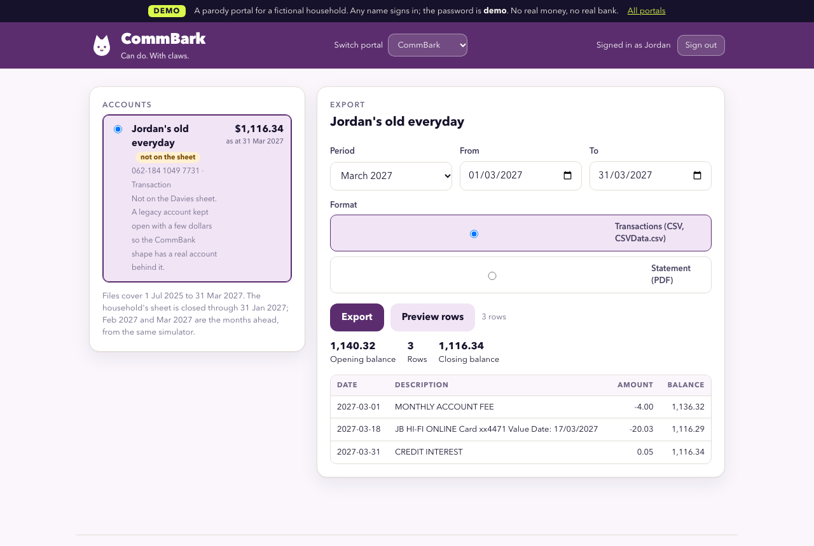
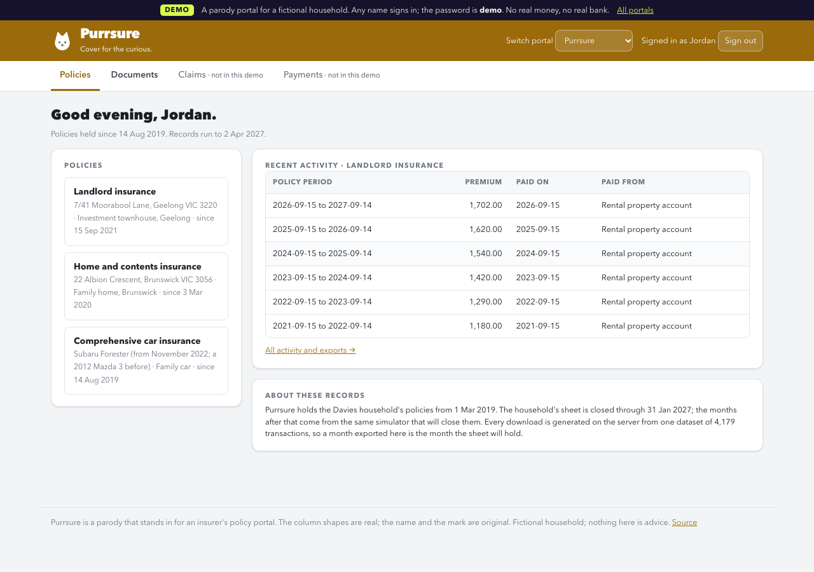

# The Kitty


A money page for one household, built the way a neobank would build it and kept the way a spreadsheet is
kept. One Google Sheet owns every number; one published page reads it, says what needs a person, shows
where the money went, tracks goals as money ("$11k of $12k"), installs on a phone, and answers questions
as a planner's note. No server, no database, no telemetry, nothing to pay for.

**Try it:** https://claude.ai/artifact/QH2gsDP8sHZmgMVKBtkwxn (the fictional Davies household; works on a phone,
add it to your home screen). **Copy the sheet:** https://docs.google.com/spreadsheets/d/1zfiCnqO36a0YmMwC8-J6iGHUGvmLdXmhbL5aPWNlExM/copy

| | |
|---|---|
|  |  |
|  |  |

## Status

Version 1.1, shipped. Verified live on 3 November 2026: live read and write through the viewer's Google Sheets
connector, the onboarding's writes, Ask the Kitty, two month-end closes through the import pipeline, light and
dark themes, phone install. See `CHANGELOG.md`; known limits are listed at the end of this file.


## What is in here

| Path | What it is |
|---|---|
| `src/engine.js` | Every number: parsing of connector strings and snapshot values, the model, verdict, upcoming, goals, leaks, search. Pure functions; `node --test test.js` runs them with the sheet as oracle. |
| `src/app.js` | The page: Home, Activity, Insights, Goals, Setup; onboarding; drawers; the three writes; Ask the Kitty. |
| `src/style.css`, `src/shell.html` | Tokens (light and dark, four accents), components, the SVG icon sprite. |
| `src/data-sources.json` | How a household gets bank data in, by country and institution, with the landing rules. Rendered on Setup. |
| `data/snapshot.json` | The Davies household as JSON, pulled from the sheet's bound Apps Script. Fictional, so it is bundled. |
| `snapshot.py` | Refreshes `data/snapshot.json` from the Apps Script JSON feed (`apps-script/Code.js`, `?format=json`). |
| `build.py` | Bundles `dist/kitty.html` (publish this) and `dist/local.html` (open locally). `--no-snapshot` for a page with no data in it. |
| `test.js` | Pinned tests on a frozen month (`fixtures/snapshot-2026-11.json`) plus invariants that also run on the live snapshot: transactions add up to the Cash Flow tab every month, accounts to the Cash metric, IDs unique. |
| `skills/bank-export/SKILL.md` | The agent skill for the monthly export, country-aware, credential-free. |
| `portals/` | The parody portals on Vercel (https://the-kitty-portals.vercel.app): static pages, four Node functions, `build-data.py`, the Playwright proof. |

## Build, test, publish

```bash
python3 snapshot.py          # after a month-end close
node --test test.js
python3 build.py             # dist/kitty.html
```

Publish `dist/kitty.html` from Claude with these capabilities: `mcp` → Google Sheets with
`get_values`, `get_spreadsheet`, `update_values`, `append_values`; `sample`; `user`; `db`; `downloads`.
Icon word: `cat`. After the first publish, set `KITTY_PAGE_URL` in `build.py` so the Setup tab's QR
code points at the page, and publish again.

Local check: `python3 -m http.server 8765 --directory dist` then open `/local.html`. The page runs
on the bundled data without any connector; connector features show as absent.

## The data model, in one paragraph

Raw tabs are append-only (Transactions, Payslips, Valuations). Input tabs are set up once (Accounts,
Categories, Goals, Loans, Assets, Subscriptions, Settings, and the Kitty tab this page owns). View tabs
are formulas only (Cash Flow, Budget, Savings Finder, Mortgage Scenarios, Tax Forecast, Compliance
Checks, Net Worth). Metrics names each headline figure once. The page draws from Metrics and the views,
derives only what a search or a window needs, and checks its derivations against the sheet in the trust
drawer. It writes three things, each to the owning tab: Kitty settings, a goal's target or date, the
safety-net target.

## The month-end close, as the banks deliver it

Two months (December 2026 and January 2027) were closed this way on 3 November 2026 to prove the model.

```bash
python3 period-close/simulate.py 2027-02      # demo only: writes the month's files as each bank would
python3 snapshot.py                     # the sheet as it stands, for de-duplication and history
python3 period-close/import_month.py 2027-02  # reads sources/, refuses rows already in the sheet, categorises
# settle period-close/2027-02/review.md in overrides.csv, run the import again, then append rows.json,
# payslips.csv and valuations.csv to the sheet, move Settings → As-of date, update Last used, read Compliance Checks
```

- Files land in `sources/<account id>/<download date>/`, one per account, in the institution's own shape
  (`period-close/adapters.py`: Harbour Bank writes like Westpac with debit and credit columns and a running
  balance; Southern Card like American Express with charges positive; Wattle Credit Union like ING). The
  adapter folds each into one signed amount; the file is never edited.
- Overlapping exports are safe in one run: each row is taken once, and a genuine double charge survives because the most copies in any one file is how many are real. Where a file prints a running balance, its last balance in the month must equal the sheet's opening balance plus every row to that date; if not, the run exits 2, `rows.json` is empty and the rows wait in `rows.held.json`. Card files print no balance, so they carry no such check.
- `import_month.py` refuses any row the sheet already holds (same date, account, description and amount,
  counted), so a file imported twice appends nothing while a genuine same-day double charge survives for the
  sheet's duplicate check to flag. December re-imported after it was appended: 51 rows, 0 to append.
- Txn IDs continue from the sheet's last. Helper columns on Transactions, Payslips and Valuations are
  ARRAYFORMULAs, so appended rows need nothing else. The one thing to get right by hand is the first empty
  row: the header makes T0001 row 2.
- The close is done when every Close check on Compliance Checks is OK and `close.items_missing` is 0.
- The sheet's bound Apps Script serves the JSON feed only while the Kitty tab says `public_feed = yes`. The demo sheet says yes because every number in it is fictional; a household with real money leaves it off and reads live through the connector instead.

## Portals (the end-to-end proof)

**https://the-kitty-portals.vercel.app** serves the Davies household's files from seven parody portals, in a plain
browser, as real downloads: Westpaw (the Westpac CSV shape), CommBark (CommBank's headerless four-column export),
Amewx (the American Express statement shape, with statement periods that close mid-month), PING (the ING shape),
PropertyMeow (owner statements per investment property), Pawroll (payslips) and Purrsure (landlord and home
insurance renewals). Sign in with **any name and the password `demo`**. Each portal lists its accounts, takes a date
range and a format, and the Export button returns a server-generated file with `Content-Disposition: attachment`:
CSV in the institution's exact column shape, PDF through pdf-lib for statements, loan statements, owner statements,
payslips and renewal notices.

The files agree with the sheet. `portals/build-data.py` builds `portals/data/months.json` from `data/snapshot.json`
(every month the sheet holds) and from `period-close/simulate.py` run in a scratch copy (the next two months), so a
closed month downloaded from a portal is byte-identical to the file under `sources/`. The CI job `portals` proves
the path with Playwright (Chromium only): sign in, download every shape for the first month after the sheet's as-of
date, run `period-close/import_month.py` against a scratch copy of the snapshot, check IDs, accounts, categories and
per-account totals against the simulator, build the engine's model over the result, then import the same files again
and get nothing to append. One account is not on the sheet: Jordan's old everyday at CommBark exists only in the
portals, so the CommBank shape has an account behind it; it is labelled on the page.

Rules: no real bank's name, logo or mark anywhere, only parody names and original wordmarks; no real credential
anywhere, and the bank-export skill still never types, reads or stores a password or a one-time code; every
dependency pinned to an exact version. The Vercel project `the-kitty-portals` has its root directory set to
`portals/`; what is live was deployed with `vercel --prod` from that folder. Auto-deploys from `main` and a preview
URL per pull request need the Vercel account's GitHub login connection, which the CLI reported missing on 4 November
2026 (`vercel git connect` in `portals/` once it is added). Run it locally with `cd portals && npm ci && npm start` (http://127.0.0.1:4173), rebuild
the data after a month-end close with `python3 portals/build-data.py`, and run the proof with `npx playwright test`.

| | |
|---|---|
|  |  |
|  |  |

## Make it yours

1. File → Make a copy of the demo sheet. Clear the three raw tabs; fill the input tabs.
2. Add the Google Sheets connector in claude.ai with the account that owns the copy.
3. Open the page, Setup → Make it yours → paste your sheet ID. It reads live from then on.
4. Export the last three months from each account (Setup → Getting your data in, or the skill), run
   `period-close/import_month.py`, settle the review, append, move the As-of date.
5. For real money, build with `--no-snapshot` and publish your own private copy.

## Known limits (what is still a tinker)

- English copy only; currency and date order follow the Kitty tab's country, nothing else is localised.
- One sheet shape. A household with different tab names or columns needs the sheet template, not this page.
- Bank export paths for the real banks are documented from product knowledge, not yet verified on each bank's site; the skill stamps them as it verifies. The parody portals' paths are the first verified entries (`demo` in `src/data-sources.json`).
- The import pipeline is Python on a laptop; a scheduled, supervised version is the next real step.
- Tested with a 925-row sheet; reads are chunked for larger ones but not yet exercised past a few thousand rows.
- Verified on Chrome, Safari (iOS) and the Claude apps. Not tested on Firefox.

## Decisions (why this shape)

Recorded on the page's Setup tab under "Why this, not that", and in the commit history. The short
version: the sheet is the only owner of numbers; the page is disposable; writes are few, narrow and
reread; demo data is bundled because it is fictional and real data never is; charts are hand-drawn
SVG with d3 for layout maths only.
